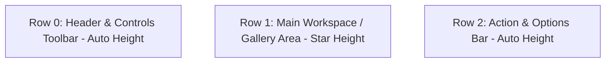

# FoliCon Modern UI Design Guidelines

This document serves as the official UI design and styling standard for **FoliCon**. It reflects the design principles, visual hierarchy, theme architecture, and component standards established during the UI modernization initiative.

All new views, dialogs, and components—as well as refactors of existing legacy interfaces—must follow these guidelines.

---

## 1. Vision & Core Principles

- **Cohesive & Desktop-First**: FoliCon is a modern Windows desktop utility. Interfaces must look integrated with Windows 11/10 aesthetics while retaining FoliCon's distinct identity.
- **Card-Based Elevation**: Group related controls, lists, and previews into structured cards (`Border` with subtle borders and rounded corners) rather than flat, cluttered grids.
- **Dynamic Theming**: Every visual element must look intentional and polished in both **Light** and **Dark** modes. Hardcoded colors are strictly prohibited.
- **Responsive & Spacious**: Generous padding, flexible column proportions, sensible window dimensions (`MinWidth`/`MinHeight`), and smooth scroll areas.
- **Clarity Over Clutter**: Toolbars group configuration logically; status pills and count badges summarize data at a glance; empty states provide clear guidance.

---

## 2. Color System & Theme Resources

### The Cardinal Rule

> [!IMPORTANT]
> **Never hardcode hex colors or named color brushes** (e.g., `#333333`, `Firebrick`, `RoyalBlue`, `Black`) in XAML views. All foregrounds, backgrounds, borders, and fills must bind dynamically to HandyControl theme brushes using `{DynamicResource ...}`.

### Standard Theme Brushes

| Category | Theme Brush Resource | Usage |
| :--- | :--- | :--- |
| **Main Surface** | `{DynamicResource RegionBrush}` | Window background, dialog surfaces, list backgrounds |
| **Card Surface** | `{DynamicResource SecondaryRegionBrush}` | Workspace cards, toolbars, list item containers |
| **Elevated Surface** | `{DynamicResource ThirdRegionBrush}` | Adorners, flyouts, dropdown surfaces |
| **Borders & Dividers** | `{DynamicResource BorderBrush}` | Card outlines, row dividers, separator lines |
| **Primary Text** | `{DynamicResource PrimaryTextBrush}` | Headings, titles, primary labels, list item text |
| **Secondary Text** | `{DynamicResource SecondaryTextBrush}` | Subtitles, hints, metadata, secondary counts |
| **Tertiary Text** | `{DynamicResource ThirdTextBrush}` | Watermarks, disabled indicators |
| **Brand Accent** | `{DynamicResource PrimaryBrush}` | Primary buttons, active toggle switches, accent badges |
| **Success** | `{DynamicResource SuccessBrush}` | Completed operations, valid states, success badges |
| **Warning** | `{DynamicResource WarningBrush}` | Cautions, modified states, pending approvals |
| **Danger / Destructive** | `{DynamicResource DangerBrush}` | Stop buttons, delete actions, error badges, heart icon |
| **Informational** | `{DynamicResource InfoBrush}` | Badges, callout panels, help hints |

---

## 3. Typography & Text Hierarchy

### Typeface

FoliCon relies on the Windows system font (**Segoe UI**). Never hardcode legacy or decorative fonts like `Cambria`, `Monotype Corsiva`, or `Courier`.

### Typographic Scale

| Role | Font Size | Font Weight | Color Brush | Sample Usage |
| :--- | :--- | :--- | :--- | :--- |
| **Window Hero Title** | `22px` | `Bold` | `PrimaryTextBrush` | AboutBox header, dialog main titles |
| **Section Header** | `15px - 16px` | `SemiBold` | `PrimaryTextBrush` | Workspace panel headers, Card headers |
| **Subheadings & Groups** | `13px - 14px` | `SemiBold` | `PrimaryTextBrush` | Control group titles, toolbar labels |
| **Body / Primary Text** | `12.5px - 13px` | `Regular` | `PrimaryTextBrush` | List item titles, descriptions, buttons |
| **Secondary / Hints** | `11px - 12px` | `Regular` | `SecondaryTextBrush` | Subtitles, path indicators, descriptions |
| **Pills & Badges** | `10px - 11px` | `SemiBold` | `White` or `SecondaryTextBrush` | Count pills, version tags, overlay IDs |

### Text Trimming & Tooltips

Whenever binding to dynamic user content, file paths, folder names, or media titles:

```xml
<TextBlock Text="{Binding SelectedDirectory}"
           FontSize="12"
           TextTrimming="CharacterEllipsis"
           ToolTip="{Binding SelectedDirectory}" />
```

Always use `TextTrimming="CharacterEllipsis"` together with `ToolTip` to ensure long text never overflows or distorts the layout.

---

## 4. Window & Dialog Conventions

### Prism & HandyWindow Integration

All modal dialogs are presented using Prism's dialog service hosting `HandyWindow`.

```xml
<prism:Dialog.WindowStyle>
    <Style TargetType="Window">
        <Setter Property="Title" Value="{Binding Title}" />
        <Setter Property="Height" Value="660" />
        <Setter Property="Width" Value="880" />
        <Setter Property="MinHeight" Value="540" />
        <Setter Property="MinWidth" Value="740" />
        <Setter Property="prism:Dialog.WindowStartupLocation" Value="CenterOwner" />
        <!-- For non-resizable small utility dialogs only: -->
        <!-- <Setter Property="ResizeMode" Value="NoResize" /> -->
        <!-- <Setter Property="SizeToContent" Value="WidthAndHeight" /> -->
    </Style>
</prism:Dialog.WindowStyle>
```

### Dialog Rules

1. **Never set `WindowStyle="ToolWindow"`**: This strips the modern HandyControl window chrome, theming, and title bar behavior.
2. **Never hardcode relative pack URIs in `<Setter Property="Icon" ...>`**: It breaks cross-assembly test runners. HandyWindow automatically inherits the application icon.
3. **Always set `MinWidth` and `MinHeight`**: Prevent dialogs from being resized into unusable states.
4. **Always set `Title="{Binding Title}"`**: Keeps the title bar synchronized with localized view model titles.
5. **Standard Dialog Buttons**:
   - Primary confirm action: `Style="{StaticResource ButtonPrimary}" IsDefault="True"`
   - Cancel / Dismiss action: `Style="{StaticResource ButtonDefault}" IsCancel="True"` (or Primary if it's the sole Close button).

---

## 5. Layout Architecture & Patterns

### 1. The 3-Tier Dialog Layout

Most full-featured dialogs (`CustomIconControl`, `Previewer`, `ProSearchResult`, `PosterPicker`) use a three-tier row layout:



### 2. Card Panel Standard

Wrap individual sections and workspaces in elevated cards:

```xml
<Border Background="{DynamicResource SecondaryRegionBrush}"
        BorderBrush="{DynamicResource BorderBrush}"
        BorderThickness="1"
        CornerRadius="8"
        Padding="12">
    <!-- Card Content -->
</Border>
```

### 3. Card Header Pattern

Every card workspace should feature a cohesive header:

```xml
<Grid Margin="2,0,2,10">
    <Grid.ColumnDefinitions>
        <ColumnDefinition Width="Auto" />  <!-- Leading Vector Icon -->
        <ColumnDefinition Width="*" />     <!-- Section Title -->
        <ColumnDefinition Width="Auto" />  <!-- Status / Count Pill -->
        <ColumnDefinition Width="Auto" />  <!-- Quick Action Button -->
    </Grid.ColumnDefinitions>

    <Path Grid.Column="0" Data="{StaticResource FolderGeometry}"
          Fill="{DynamicResource PrimaryBrush}" Width="16" Height="16"
          Stretch="Uniform" VerticalAlignment="Center" Margin="0,0,8,0" />

    <TextBlock Grid.Column="1" Text="Folders"
               FontSize="15" FontWeight="SemiBold"
               Foreground="{DynamicResource PrimaryTextBrush}"
               VerticalAlignment="Center" />

    <Border Grid.Column="2" Background="{DynamicResource PrimaryBrush}"
            CornerRadius="10" Padding="8,2" VerticalAlignment="Center" Margin="0,0,6,0">
        <TextBlock Text="{Binding Directories.Count, StringFormat='{}{0} folders'}"
                   Foreground="White" FontSize="11" FontWeight="SemiBold" />
    </Border>

    <Button Grid.Column="3" Style="{StaticResource ButtonIcon}"
            hc:IconElement.Geometry="{StaticResource TrashGeometry}"
            Command="{Binding ClearFoldersCommand}" Width="26" Height="26" />
</Grid>
```

---

## 6. Controls & Micro-Interactions

### Buttons

- **Primary Action**: `Style="{StaticResource ButtonPrimary}"` — Used for main confirmation (Apply, Save, Generate).
- **Secondary Action**: `Style="{StaticResource ButtonDefault}"` — Used for Browse, Options, Undo, View.
- **Destructive Action**: `Style="{StaticResource ButtonDanger}"` — Used for Cancel Search, Remove, Reset.
- **Icon-Only Button**: `Style="{StaticResource ButtonIcon}"` — Used for toolbar icons, clear buttons, copy icons. Set `hc:IconElement.Geometry`, `Width="26"`, `Height="26"`, `Padding="0"`.

### Toggle Switches vs Checkboxes

> [!TIP]
> **Prefer Toggle Switches over Checkboxes** for feature flags, view options, and visibility toggles (`Only keep exact matches`, `Show Rating`, `Show Overlay`, `Subfolder Processing`).

```xml
<StackPanel Orientation="Horizontal" VerticalAlignment="Center">
    <ToggleButton Style="{StaticResource ToggleButtonSwitch}"
                  IsChecked="{Binding MyFlag}"
                  VerticalAlignment="Center" />
    <TextBlock Text="Option Description"
               FontSize="13"
               VerticalAlignment="Center"
               Margin="10,0,0,0"
               Foreground="{DynamicResource PrimaryTextBrush}" />
</StackPanel>
```

### Search & Text Inputs

Use HandyControl extended inputs with clear button support:

```xml
<hc:TextBox Text="{Binding SearchFilter, UpdateSourceTrigger=PropertyChanged}"
            hc:InfoElement.Placeholder="Search overlays..."
            hc:InfoElement.ShowClearButton="True"
            Height="32" Width="220" />
```

### Badges & Pill Tags

Use subtle rounded containers for metadata, ratings, versions, and counts:

```xml
<!-- Primary Accent Pill -->
<Border Background="{DynamicResource PrimaryBrush}"
        CornerRadius="10" Padding="8,2" VerticalAlignment="Center">
    <TextBlock Text="v5.3.1" Foreground="White" FontSize="11" FontWeight="SemiBold" />
</Border>

<!-- Secondary Subtle Pill -->
<Border Background="{DynamicResource RegionBrush}"
        BorderBrush="{DynamicResource BorderBrush}"
        BorderThickness="1"
        CornerRadius="10" Padding="8,2" VerticalAlignment="Center">
    <TextBlock Text="512 × 512 HD" Foreground="{DynamicResource SecondaryTextBrush}" FontSize="11" FontWeight="SemiBold" />
</Border>
```

### Busy & Loading Indicators

Never leave the UI frozen without visual feedback:

1. **In-place / Inline**: Use `<hc:LoadingCircle Width="24" Height="24" />`.
2. **Modal / Overlay**: Wrap in `<hc:BusyIndicator>` or a dimmed overlay with an elevated card:

```xml
<Border Background="{DynamicResource RegionBrush}"
        BorderBrush="{DynamicResource BorderBrush}"
        BorderThickness="1" CornerRadius="10" Padding="28,20">
    <StackPanel HorizontalAlignment="Center">
        <hc:LoadingCircle Width="36" Height="36" Margin="0,0,0,14" />
        <TextBlock Text="Processing folders (14/30)..."
                   FontWeight="SemiBold" FontSize="14"
                   Foreground="{DynamicResource PrimaryTextBrush}" />
        <Button Style="{StaticResource ButtonDanger}"
                Content="Cancel" Margin="0,14,0,0" Height="30" />
    </StackPanel>
</Border>
```

### Empty States

When lists or searches yield zero items, provide friendly empty states:

```xml
<StackPanel HorizontalAlignment="Center" VerticalAlignment="Center">
    <Path Data="{StaticResource AutoSparklesGeometry}"
          Fill="{DynamicResource SecondaryTextBrush}"
          Width="32" Height="32" Stretch="Uniform" Margin="0,0,0,12" />
    <TextBlock Text="No overlays match your search"
               FontSize="15" FontWeight="SemiBold"
               Foreground="{DynamicResource PrimaryTextBrush}" />
    <TextBlock Text="Try clearing or changing your filter criteria."
               FontSize="12" Foreground="{DynamicResource SecondaryTextBrush}" Margin="0,4,0,0" />
</StackPanel>
```

---

## 7. Vector Iconography System

All vector glyphs are declared in [`FoliCon/Resources/Dictionaries/GeometryResources.xaml`](../FoliCon/Resources/Dictionaries/GeometryResources.xaml). Standard coordinates are based on 24×24 viewBox path definitions.

### Frequently Used Icons

- **Folders & Files**: `FolderGeometry`, `DocGeometry`, `CleanFolderGeometry`
- **Media & Entertainment**: `FilmGeometry`, `TvGeometry`, `GamepadGeometry`
- **Overlays & Design**: `PaletteGeometry`, `PhotoGalleryGeometry`, `StoreGeometry`, `ModernWandGeometry`
- **Actions & Tools**: `CheckCircleGeometry`, `RefreshGeometry`, `CopyGeometry`, `TrashGeometry`, `EyeGeometry`, `WrenchGeometry`, `SettingGeometry`
- **Community & Social**: `GithubGeometry`, `HeartGeometry`, `ExternalLinkGeometry`

### Usage Pattern

```xml
<!-- Inline Path Icon -->
<Path Data="{StaticResource FolderGeometry}"
      Fill="{DynamicResource PrimaryBrush}"
      Width="16" Height="16"
      Stretch="Uniform"
      VerticalAlignment="Center" />

<!-- Inside a Button -->
<Button Style="{StaticResource ButtonDefault}">
    <StackPanel Orientation="Horizontal" VerticalAlignment="Center">
        <Path Data="{StaticResource CopyGeometry}"
              Fill="{DynamicResource PrimaryTextBrush}"
              Width="13" Height="13" Stretch="Uniform" Margin="0,0,6,0" />
        <TextBlock Text="Copy Image" FontSize="12" VerticalAlignment="Center" />
    </StackPanel>
</Button>
```

---

## 8. Technical Gotchas & WPF Architecture Rules

### 1. Never Use Custom Markup Extensions in `Setter.Value`

> [!CAUTION]
> In WPF, `<Setter Property="..." Value="{extension:Lang ...}" />` inside a `Style.Triggers` or `DataTrigger` throws `XamlParseException` / `ArgumentException` at runtime:
> *`'LangExtension' is not valid for Setter.Value. The only supported MarkupExtension types are DynamicResourceExtension and BindingBase or derived types.`*
>
> **Solution**: Use `TextToVisibilityConverter` and `InvertedTextToVisibilityConverter` to toggle visibility between distinct `TextBlock`s, or bind to ViewModel properties.

### 2. Mandatory Smoke Tests for Every View

Whenever modifying or introducing a XAML view, write a smoke test in `FoliconTest`:

```csharp
[Collection(XamlLoadingCollection.name)]
public class MyViewSmokeTests
{
    [Fact]
    public void MyView_InstantiatesAndLoadsWithoutException()
    {
        using var host = new WpfTestHost();
        WpfTestHost.Invoke(() =>
        {
            ViewModelLocationProvider.SetDefaultViewModelFactory(_ => new object());

            var view = new MyView();
            var size = new Size(880, 640);
            view.Measure(size);
            view.Arrange(new Rect(size));
            view.UpdateLayout();

            Assert.NotNull(view);
        });
    }
}
```

This guarantees that all merged dictionaries, converters, styles, vector geometries, and data templates parse cleanly without throwing `XamlParseException` on users' machines.

---

## 9. Checklists for Reviewing New UI

Before submitting or committing UI changes:

- [ ] **No Hardcoded Colors**: Verified that all backgrounds, foregrounds, and borders use dynamic resources.
- [ ] **Dark & Light Theme Tested**: Checked that text and card surfaces maintain strong contrast in both themes.
- [ ] **Window Style Configured**: Dialog has appropriate `Width`, `Height`, `MinWidth`, `MinHeight`, and startup location.
- [ ] **Toggle Switches**: Feature options use `ToggleButtonSwitch` with descriptive label margins.
- [ ] **Vector Icons**: Uses centralized `GeometryResources.xaml` vectors with `Stretch="Uniform"`.
- [ ] **Text Trimming**: Truncated text fields include `TextTrimming="CharacterEllipsis"` and `ToolTip`.
- [ ] **Code-Behind Minimal**: UI interaction handled via Prism MVVM commands and XAML triggers.
- [ ] **Unit & Smoke Tests Pass**: Verified with `dotnet test FoliconTest\FoliconTest.csproj`.
